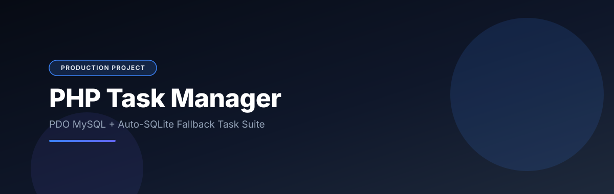
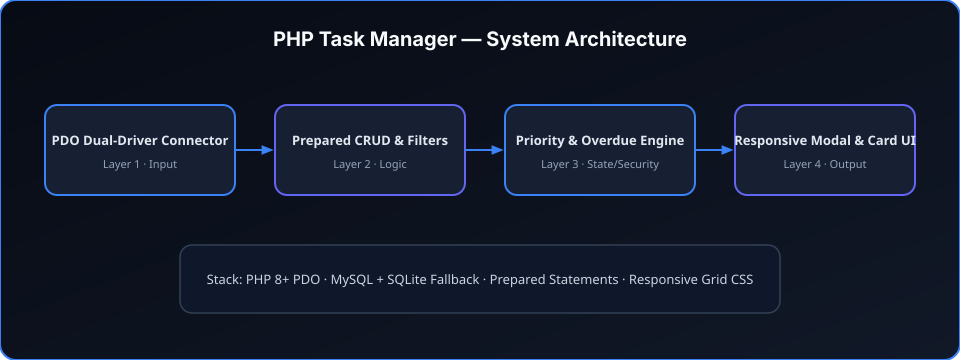
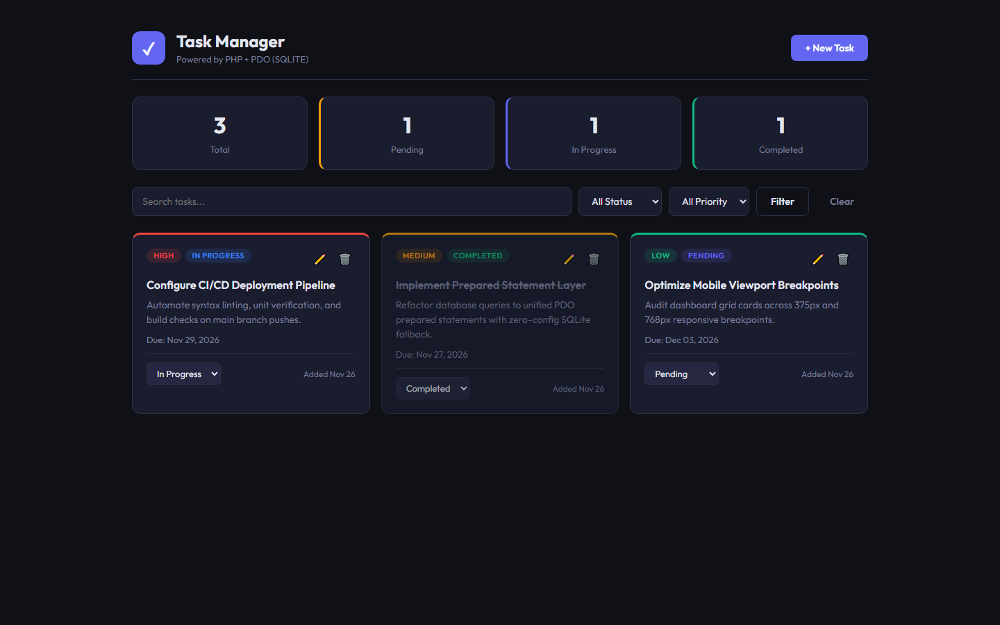

# PHP Task Manager

> PDO MySQL + Auto-SQLite Fallback Task Suite

    



## 📌 Executive Overview
Responsive PHP 8+ task management application using unified PDO prepared statements with MySQL primary support and seamless automatic zero-config SQLite fallback (`database.db`).

---

## 🏛️ System Architecture



---

## 📷 Live Application Interface

Below is a genuine live capture rendered from the running local application:



---

## 🛠️ Tech Stack
- **PHP 8+ PDO**
- **MySQL + SQLite Fallback**
- **Prepared Statements**
- **Responsive Grid CSS**

---

## 🚀 How to Run

1. **Clone the repository:**
   ```bash
   git clone https://github.com/royalodi/php-task-manager.git
   cd php-task-manager
   ```

2. **Launch locally:**
   Run `php -S localhost:8000` inside the project directory (automatically uses MySQL if available or falls back cleanly to SQLite `database.db`).

---

## 👨‍💻 Author & Lead Maintainer

<table>
  <tr>
    <td align="center" width="150" valign="middle">
      <a href="https://github.com/royalodi">
        
      </a>
      <br /><br />
      <b>Royal Odi</b><br />
      <sub><i>Full-Stack Engineer</i></sub>
    </td>
    <td valign="top">
      <p>
        Designed, engineered, and maintained by <b>Royal Odi</b>. Full-Stack Engineer focused on building scalable web architectures, robust backend systems, and responsive, high-performance digital experiences.
      </p>
      <p>
        <a href="https://github.com/royalodi"></a>
        <a href="mailto:royalodi.dev@gmail.com"></a>
        <a href="https://github.com/royalodi?tab=repositories"></a>
      </p>
    </td>
  </tr>
</table>

---

## 📄 License
Distributed under the **MIT License**.
